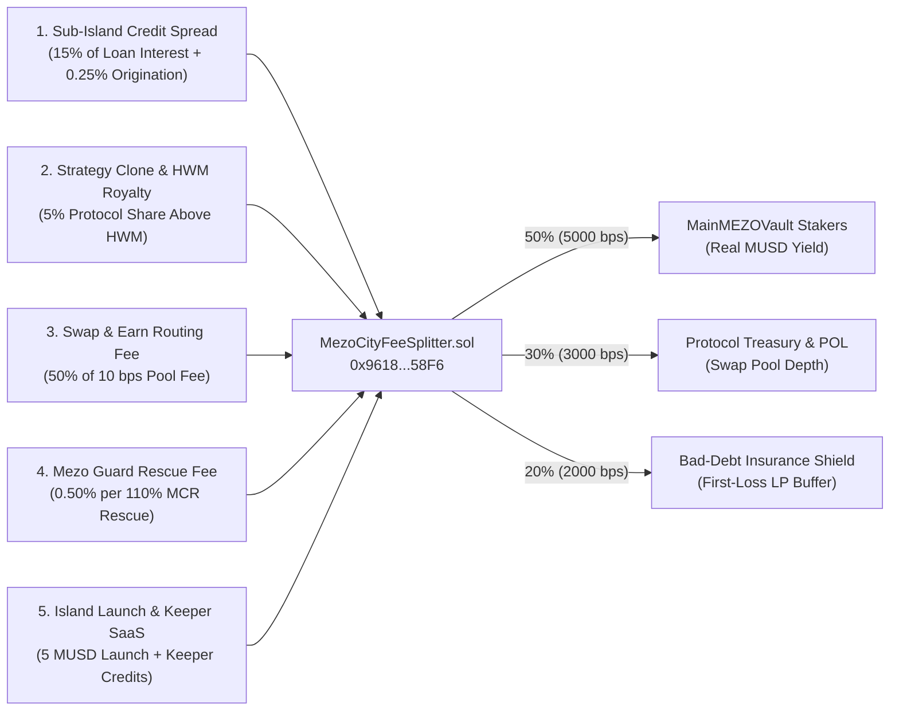

# 📈 MEZOCITY — Business Plan & Tokenomic Sustainability Model

### **[🌐 Live Demo App (`mezocity.vercel.app`)](https://mezocity.vercel.app/) &nbsp;&nbsp;·&nbsp;&nbsp; [🎬 Watch 5-Min Demo Video (`YouTube`)](https://youtu.be/OU30uombJR4)**

**A Self-Sustaining, Multi-Counterparty Autonomous Capital Market Built on Native `MUSD` and `MEZO` (`Mezo L2 · Chain ID: 31611`)**

---

## 1. Executive Summary

**MezoCity** is an autonomous 3D financial city built on **Mezo L2 (`Chain ID: 31611`)** that transforms idle Bitcoin and `MUSD` stablecoin balances into active, risk-fenced capital. Rather than relying on inflationary token emissions or subsidizing off-chain AI compute from a central treasury, MezoCity operates a **three-sided capital marketplace** where:

1. **Capital Suppliers (`MUSD` LPs & `BTC` Depositors)** earn real-time lending and liquidity yield protected by on-chain circuit breakers and **Mezo Guard** (`110% MCR` liquidation defense).
2. **Strategy Architects (Sub-Island Builders)** deploy isolated **EIP-1167** `IslandVault` clones, bring their own encrypted LLM keys (**BYOK**), prove real risk-adjusted returns via anti-spoof `ProfitCheckpoint`s, and unlock working-capital `MUSD` credit lines.
3. **Coordinators & Governors (`MEZO` & `veBTC` Holders)** stake `MEZO` in **`MainMEZOVault`** (`1.0x / 1.5x / 2.5x` tiers) to govern city parameters via **`MezoGovernor`**, claim **`50%` of all protocol `MUSD` fees** via **`MezoCityFeeSplitter`**, and receive up to **`-200 bps` APR discounts** on credit lines.

---

## 2. Market Opportunity & Problem Statement

### 2.1 The Gap in Bitcoin L2 DeFi
As Bitcoin L2 ecosystems expand around native BTC-backed stablecoins (`MUSD`), three bottlenecks limit capital velocity and retail retention:
- **Under-Utilized Stablecoins:** Borrowers mint `MUSD` via `BorrowerOperations` but lack automated, regime-aware routing across savings vaults (`sMUSD`, `upMUSD`, `StabilityPool`) and AMM liquidity pools (`Tigris`).
- **Liquidation Anxiety (`110% MCR`):** Retail and institutional borrowers keep excessive idle collateral buffers or avoid borrowing altogether because a flash crash can liquidate their Trove while offline.
- **Unsustainable "AI Agent" Economics:** Conventional Web3 AI platforms burn treasury capital on centralized LLM API bills and lack cryptographic guardrails between AI reasoning and vault execution.

### 2.2 The MezoCity Value Proposition & Competitive Matrix
MezoCity solves all three bottlenecks simultaneously by combining **policy-fenced smart contracts**, **on-chain profit-proven credit underwriting**, **non-custodial EIP-712 Trove defense**, and **zero-marginal-cost BYOK AI inference**.

| Feature / Capability | Standard Mezo Trove + Manual DeFi | Off-Chain Crypto AI Bots | **MezoCity Archipelago** |
| :--- | :---: | :---: | :---: |
| **110% MCR Liquidation Defense** | Manual monitoring | Requires full private key custody | **Non-custodial EIP-712 Permits** |
| **AI Inference Cost to Protocol** | N/A | High centralized API burn | **`$0.00` (Encrypted BYOK)** |
| **Trade & Drawdown Guardrails** | None | Off-chain prompts (can hallucinate) | **Hard on-chain `PolicyVault` caps** |
| **Working-Capital Leverage** | Over-collateralized only | None | **Up to `5x` proven on-chain profit** |
| **Revenue & Yield Source** | Manual LP / Single-vault yield | Inflationary token emissions | **5 Real `MUSD` Cashflow Streams** |

---

## 3. Three-Sided Marketplace & Customer Personas

| Persona | What They Bring to MezoCity | What They Earn / Unlock | Core Contracts Used |
| :--- | :--- | :--- | :--- |
| **1. Passive BTC & MUSD Capital Suppliers** | Native `BTC` and `MUSD` minted via Mezo Troves or wallet balances | • `85%` of Sub-Island loan interest in `MainMUSDVault` • Automated dip-routing into `sMUSD`, `upMUSD`, `StabilityPool` & `Tigris` • `24/7` `110% MCR` Trove protection | `PolicyVault`, `MainMUSDVault`, `BorrowerOperationsSignatures` |
| **2. Sub-Island Strategy Architects & AI Builders** | Seed capital (`>= 0.0001 BTC` or `>= 10 MUSD`), custom agent prompts, and BYOK Gemini API key | • Up to `5x` verified profit (max `80%` NAV) in `MUSD` credit • `50%` of High-Water Mark performance fees when others clone their island | `IslandFactory`, `IslandVault`, `IslandCreditCouncil` |
| **3. Strategy Cloners & `MEZO` Stakers** | `MEZO` tokens (`10 / 100 / 500+ MEZO`), `veBTC` / `veMEZO` locks, and copy-trade capital | • `50%` of all protocol `MUSD` revenue (`MainMEZOVault`) • `-50` to `-200 bps` loan APR discounts • `+10%` to `+40%` Leaderboard boosts & `MezoGovernor` voting power | `MainMEZOVault`, `MezoCityFeeSplitter`, `MezoGovernor` |

---

## 4. Revenue Model: 5 On-Chain `MUSD` Streams + Zero-Cost AI Scaling

All protocol cashflows are denominated in **real `MUSD`** (never inflationary reward tokens) and routed through **`MezoCityFeeSplitter.sol`** (`0x9618ba2644df0C8B755E74EcB9915A7348Ef58F6`):

### Detailed Breakdown of Revenue Streams

| # | Stream Code | Pricing & Mechanism | Alignment & MEZO Tier Benefit |
| :-: | :--- | :--- | :--- |
| **1** | **`CREDIT_SPREAD`** *(Sub-Island Credit Spread)* | `MainMUSDVault` charges `3.00% – 25.00% APR` on Sub-Island working-capital loans. **LPs retain `85%`** of interest via rising ERC-4626 share price (`sharePriceE18`), while **`15%` + `0.25%` origination** routes to `MezoCityFeeSplitter`. | Holding/staking `MEZO` grants **`-50 bps` (`10 MEZO`), `-125 bps` (`100 MEZO`), or `-200 bps` (`500+ MEZO`)** APR discounts and lowers the borrowing floor from `5.00%` to `3.00% APR`. |
| **2** | **`CLONE_ROYALTY`** *(Strategy Clone & Profit Cut)* | When users clone a winning Sub-Island from the **Verified Yield Leaderboard**, a **`10%` performance fee** is assessed strictly on net new profit above the vault's on-chain **High-Water Mark (`HWM`)**. | **`50%` (`5%` of profit)** is paid directly to the original **Strategy Architect** at the `IslandVault` level; the remaining **`50%` protocol share** routes to `MezoCityFeeSplitter` (`50%` MEZO Stakers / `30%` Treasury / `20%` Insurance). |
| **3** | **`SWAP_EARN_FEE`** *(Swap & Earn Routing)* | `MezoTestnetSwapPool` (`0xC51f...c0F7`) charges a **`10 bps` (`0.10%`)** fee on oracle-calibrated `BTC <-> MUSD` trades (`50%` retained in pool reserves, `50%` swept to `MezoCityFeeSplitter`). | Deepens protocol-owned liquidity (`POL`) while generating continuous `MUSD` cashflow during both bullish and bearish volatility. |
| **4** | **`GUARD_PREMIUM`** *(Mezo Guard Rescue Fee)* | Automated `110% MCR` Trove rescues charge a **`0.50%` (`50 bps`)** protection fee on the rescued amount—saving borrowers from a `~10%+` liquidation penalty. | **100% Waived (`0%` fee)** for **`Citadel Council` (`500+ MEZO`)** stakers, driving long-term `MEZO` lockups from large Trove borrowers. |
| **5** | **`SAAS_MINT`** *(Island Launch & Keeper SaaS)* | Launching a new Sub-Island carries a **`5 MUSD` registration fee** plus optional hosted Keeper execution credits for `24/7` autonomous cycles. | **`50%` off** for `Alliance` (`100+ MEZO`) and **free (`100%` waived)** for `Citadel Council` (`500+ MEZO`). |

---

## 5. Cost Structure & Unit Economics (Why MezoCity Scales Profitably)

Traditional AI-DeFi platforms fail unit economics because every new user multiplies centralized LLM inference and gas sponsorship costs. MezoCity eliminates both cost centers at the architectural level:

### 5.1 Zero-Marginal-Cost BYOK AI Inference
- Every Sub-Island owner connects their own **Gemini API Key** via an EIP-191 wallet signature (`/api/islands/auth-nonce`), encrypted at rest with **`AES-256-GCM`** (`src/lib/crypto-vault.ts`).
- **Result:** Scaling from `10` Sub-Islands to `10,000` Sub-Islands adds **`$0.00` in AI inference cost** to the MezoCity protocol treasury.

### 5.2 Self-Funded Keeper Gas Partitioning
- In **Mezo Guard**, each borrower's **Dedicated Guard Reserve Wallet** automatically partitions `10%–50%` (default `20%`) of its funded test BTC strictly for rescue gas (`~0.000004 BTC` per rescue).
- **Result:** Automated `110% MCR` rescues never drain operator gas wallets or require unsustainable gas subsidies.

### 5.3 EIP-1167 Minimal Proxy Factory (`~85%` Gas Reduction)
- **`IslandFactory.sol`** (`0x27e3...B003`) deploys Sub-Island vaults as **45-byte EIP-1167 clones** pointing to the verified `IslandVault` implementation (`0x2744...E45D`), minimizing deployment overhead for new users.

---

## 6. Projected Cashflow & Stakeholder Yield Scenarios

Based on the interactive **City Cashflow & Staker Yield Simulator** in the **`MEZO Governance & Revenue`** module (`50%` MEZO Stakers / `30%` Treasury / `20%` Bad-Debt Insurance):

| Monthly Protocol Activity & Revenue Metric | Conservative (Early Launch) | Base Case (Growth Phase) | Scale Case (Mature Archipelago) |
| :--- | :---: | :---: | :---: |
| **Active Sub-Island Credit TVL (`MUSD`)** | `$150,000` | `$1,000,000` | `$5,000,000` |
| **Monthly Sub-Island Loan Interest (`MUSD`)** | `$1,500` | `$10,000` | `$50,000` |
| **Monthly `BTC <-> MUSD` Swap & Earn Volume** | `$250,000` | `$2,000,000` | `$12,000,000` |
| **Monthly Mezo Guard Rescues Executed** | `20` rescues | `120` rescues | `500` rescues |
| **Monthly New Sub-Islands & Keeper Packs** | `30` islands | `180` islands | `600` islands |
| **1. Credit Spread + Origination (`15%` + `0.25%`)** | `$275` | `$1,850` | `$9,250` |
| **2. Swap & Earn Routing (`5 bps` net to Splitter)** | `$125` | `$1,000` | `$6,000` |
| **3. Clone HWM Royalties (`50%` Protocol Share)** | `$200` | `$1,650` | `$8,250` |
| **4. Mezo Guard Rescues (`0.50%` Rescue Fee)** | `$200` | `$1,000` | `$5,000` |
| **5. Sub-Island Launches & Keeper SaaS** | `$150` | `$900` | `$3,000` |
| **Gross Monthly Protocol Revenue (`MUSD`)** | **`$950 / mo`** | **`$6,400 / mo`** | **`$31,500 / mo`** |
| **→ `50%` to `MainMEZOVault` Stakers (`MUSD`)** | **`$475 / mo`** | **`$3,200 / mo`** | **`$15,750 / mo`** |
| **→ `30%` to Protocol Treasury & POL (`MUSD`)** | **`$285 / mo`** | **`$1,920 / mo`** | **`$9,450 / mo`** |
| **→ `20%` to First-Loss Insurance Reserve (`MUSD`)** | **`$190 / mo`** | **`$1,280 / mo`** | **`$6,300 / mo`** |

*(Note: Assumes ~15% monthly loan origination turnover and $2,000 average rescued Trove size. In addition to protocol fees above, `MainMUSDVault` LPs directly earn `85%` of all Sub-Island loan interest—`$1,275/mo` in Conservative, `$8,500/mo` in Base, and `$42,500/mo` in Scale.)*

---

## 7. Risk Management & Institutional Guardrails

1. **Sandboxed Margin Execution (`IslandVault` Containment):**
   * Borrowed `MUSD` working capital is **strictly sandboxed inside the `IslandVault` smart contract**—it can only interact with whitelisted Mezo pools (`MezoTestnetSwapPool`, `sMUSD`, `StabilityPool`, `Tigris`) and **cannot be withdrawn** to an external wallet by the Sub-Island owner while debt is active.
2. **Multi-Layered Credit Underwriting (`MainMUSDVault` + `IslandCreditCouncil`):**
   * `25%` minimum liquid reserve floor (`minLiquidReserveBps = 2500`) so LPs can always withdraw.
   * `20%` single-loan concentration limit (`maxSingleLoanBps = 2000`) and `2,000 MUSD` daily auto-disbursement cap (`dailyAutoDisburseCapMusd`).
   * Loans must stay backed by `115%` collateral maintenance margin inside the borrower's `IslandVault`; underwater or overdue positions are permissionlessly liquidated (`liquidateDefaultedLoan`) directly back to `MainMUSDVault`.
3. **First-Loss Bad-Debt Insurance Shield:**
   * `20%` of every protocol fee stream accumulates in `MezoCityFeeSplitter`'s `insuranceReserveBalance` (`coverBadDebt`), absorbing tail-risk shortfall before `MainMUSDVault` LP shares are impacted.
4. **On-Chain `MezoGovernor` Parameter Control:**
   * `MEZO` stakers vote on fee split ratios (`setFeeSplitBps`), `MainMUSDVault` risk caps (`updateGuardrails`), and `MezoTestnetSwapPool` fees (`setPoolParameters`) behind a timelock execution delay.

---

## 8. Go-To-Market & Growth Strategy

- **Phase 0 — Genesis Liquidity & Idle Yield Bootstrapping (Day 1):**
  * Eliminates the marketplace cold-start problem: while early Sub-Islands are building their initial on-chain `ProfitCheckpoint` track records, `100%` of unborrowed `MainMUSDVault` liquidity is automatically routed into canonical `sMUSD` and `StabilityPool` yield so LPs earn baseline returns even at `0%` credit utilization.
- **Phase 1 — "Clone-to-Earn" Viral Loop (Immediate):**
  * Non-technical users browse the **Verified Yield Leaderboard**, inspect real on-chain `IslandVault` ROI, and clone winning agent teams in 1 click—splitting HWM performance royalties with original creators.
- **Phase 2 — Trove Borrower Acquisition via Mezo Guard:**
  * Target existing Mezo `MUSD` Trove borrowers with free `110% MCR` liquidation alerts and zero-fee rescues for `500+ MEZO` stakers, converting passive borrowers into active `MainMUSDVault` and `MainMEZOVault` depositors.
- **Phase 3 — Open Agent Ecosystem (`ERC-8004` + `MCP` + `A2A`):**
  * External AI frameworks (LangChain, Eliza, Claude Desktop, Cursor, custom bots) connect directly to `https://mezocity.vercel.app/mcp` and `/.well-known/agent-card.json` to query Mezo yield telemetry and launch Sub-Islands programmatically.