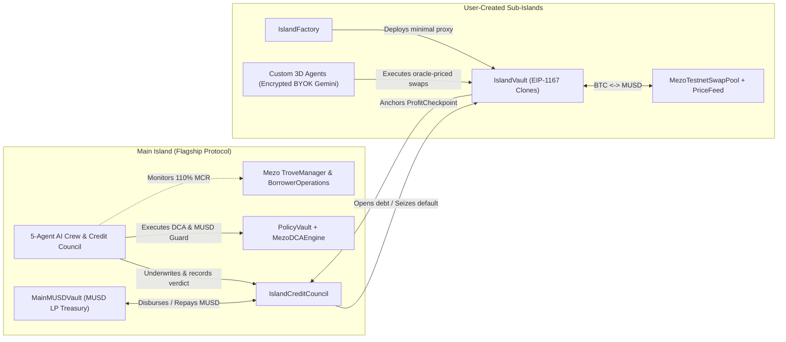

# Mezo Town — Autonomous AI Crew, Sub-Island Credit Ecosystem & MUSD Guard

**Mezo Town** (`mezocity-4lpha-polly`) is an interactive 3D clay-diorama DeFi platform and multi-agent control plane deployed on **Mezo Testnet (`Chain ID: 31611`)**. It pairs a flagship **Main Island** (powered by an on-chain ERC-8004 5-Agent Crew, Policy-Locked BTC DCA Vaults, live Mezo MUSD Trove borrowing + liquidation guard, and the Main MUSD Treasury Vault) with **user-created Sub-Islands** where builders seed capital, design custom 3D agents and vaults, connect their own Gemini API key, prove on-chain trading profitability, and borrow MUSD credit lines underwritten by the Main Island Credit Council.

---

## Network & Verified Smart Contracts — Mezo Testnet

| Parameter | Value |
| :--- | :--- |
| **Network Name** | Mezo Testnet |
| **Chain ID** | `31611` (`0x7b7b`) |
| **Native Gas Token** | `BTC` (`18` decimals) |
| **RPC / WebSocket** | `https://rpc.test.mezo.org` / `wss://rpc-ws.test.mezo.org` |
| **Block Explorer** | `https://explorer.test.mezo.org` |
| **Verification API** | `https://api.explorer.test.mezo.org/api/` (Blockscout) |

All 8 smart contracts are deployed and **fully verified** (`Solidity v0.8.24+commit.e11b9ed9`, EVM `paris`, optimizer enabled with `200` runs, `via_ir = true`) on the Mezo Testnet Blockscout Explorer.

### 1. Sub-Island & Main MUSD Credit Ecosystem Contracts

| Contract | Source | Verified Address & Blockscout Link | Role |
| :--- | :--- | :--- | :--- |
| **`MainMUSDVault`** | [`contracts/src/MainMUSDVault.sol`](./contracts/src/MainMUSDVault.sol) | [`0xFb92f088843985a6329681883869b2F0D0212340`](https://explorer.test.mezo.org/address/0xFb92f088843985a6329681883869b2F0D0212340?tab=contract) | Main Island MUSD LP treasury with virtual-share inflation protection, O(1) interest accrual, reserve ratio floors, and rolling 24h auto-disbursement caps. |
| **`MezoTestnetSwapPool`** | [`contracts/src/MezoTestnetSwapPool.sol`](./contracts/src/MezoTestnetSwapPool.sol) | [`0xC51f73FeB35b1b338108dD571a6983BeAd08c0F7`](https://explorer.test.mezo.org/address/0xC51f73FeB35b1b338108dD571a6983BeAd08c0F7?tab=contract) | Oracle-calibrated BTC <-> MUSD swap venue priced against Mezo's `PriceFeed` for Sub-Island `IslandVault` executions. |
| **`IslandVault` (Impl)** | [`contracts/src/IslandVault.sol`](./contracts/src/IslandVault.sol) | [`0x2744315d000665E271FBFB41bB2204607807E45D`](https://explorer.test.mezo.org/address/0x2744315d000665E271FBFB41bB2204607807E45D?tab=contract) | EIP-1167 minimal proxy implementation for isolated Sub-Island vaults with internal balance tracking, proportional cost-basis scaling, profit checkpoints, and default collateral seizure. |
| **`IslandFactory`** | [`contracts/src/IslandFactory.sol`](./contracts/src/IslandFactory.sol) | [`0x27e3d7116bb84f0C978377a3015441F7608aB003`](https://explorer.test.mezo.org/address/0x27e3d7116bb84f0C978377a3015441F7608aB003?tab=contract) | Deploys deterministic `IslandVault` clones when users create Sub-Islands seeded with BTC and/or MUSD (`>= 0.0001 BTC` or `>= 10 MUSD`). |
| **`IslandCreditCouncil`** | [`contracts/src/IslandCreditCouncil.sol`](./contracts/src/IslandCreditCouncil.sol) | [`0xeECf05f26534E66C9C4E950BB7504Bb83a7FcA9c`](https://explorer.test.mezo.org/address/0xeECf05f26534E66C9C4E950BB7504Bb83a7FcA9c?tab=contract) | Bridges Sub-Island verified `ProfitCheckpoint` proofs, AI Credit Council underwriting verdicts, `MainMUSDVault` disbursements, repayments, and default liquidations. |

### 2. Main Island Autonomous Crew & DCA Contracts

| Contract | Source | Verified Address & Blockscout Link | Role |
| :--- | :--- | :--- | :--- |
| **`AgentRegistry`** | [`contracts/src/AgentRegistry.sol`](./contracts/src/AgentRegistry.sol) | [`0x4e6a49b021f01fbbA71408de556aA41aC491A426`](https://explorer.test.mezo.org/address/0x4e6a49b021f01fbbA71408de556aA41aC491A426?tab=contract) | On-chain ERC-8004 agent registry storing agent metadata, operator addresses, A2A agent card URIs, MCP endpoints, and reputation/execution stats. |
| **`PolicyVault`** | [`contracts/src/PolicyVault.sol`](./contracts/src/PolicyVault.sol) | [`0xb3A7ab7be5116737b05B7682aCaC62e7D54B1477`](https://explorer.test.mezo.org/address/0xb3A7ab7be5116737b05B7682aCaC62e7D54B1477?tab=contract) | Policy-enforced BTC vault validating `maxSingleTradeBps`, `maxDailyDrawdownBps`, `minConfidenceBps`, `cooldownSeconds`, and `emergencyLock` before execution. |
| **`MezoDCAEngine`** | [`contracts/src/MezoDCAEngine.sol`](./contracts/src/MezoDCAEngine.sol) | [`0x3118372cAc92B14d2C733bA625739f1A31084701`](https://explorer.test.mezo.org/address/0x3118372cAc92B14d2C733bA625739f1A31084701?tab=contract) | Autonomous BTC DCA scheduler and on-chain error rectification engine (`rectifyAndExecuteDCASlice`) gated by `PolicyVault`. |

### 3. Integrated Mezo Testnet Protocol Contracts

Configured in [`src/lib/mezo-chain.ts`](./src/lib/mezo-chain.ts):

| Protocol Contract | Address |
| :--- | :--- |
| **MUSD Token (ERC-20)** | [`0x118917a40FAF1CD7a13dB0Ef56C86De7973Ac503`](https://explorer.test.mezo.org/address/0x118917a40FAF1CD7a13dB0Ef56C86De7973Ac503) |
| **TroveManager** | [`0xE47c80e8c23f6B4A1aE41c34837a0599D5D16bb0`](https://explorer.test.mezo.org/address/0xE47c80e8c23f6B4A1aE41c34837a0599D5D16bb0) |
| **BorrowerOperations** | [`0xCdF7028ceAB81fA0C6971208e83fa7872994beE5`](https://explorer.test.mezo.org/address/0xCdF7028ceAB81fA0C6971208e83fa7872994beE5) |
| **PriceFeed** | [`0x86bCF0841622a5dAC14A313a15f96A95421b9366`](https://explorer.test.mezo.org/address/0x86bCF0841622a5dAC14A313a15f96A95421b9366) |
| **HintHelpers** | [`0x4e4cBA3779d56386ED43631b4dCD6d8EacEcBCF6`](https://explorer.test.mezo.org/address/0x4e4cBA3779d56386ED43631b4dCD6d8EacEcBCF6) |
| **SortedTroves** | [`0x722E4D24FD6Ff8b0AC679450F3D91294607268fA`](https://explorer.test.mezo.org/address/0x722E4D24FD6Ff8b0AC679450F3D91294607268fA) |

---

## System Architecture



### Main Island Modules

1. **5-Agent Autonomous Crew (`Crew (5 AI)` tab — [`CrewAgentsPanel.tsx`](./src/components/CrewAgentsPanel.tsx))**:
   - **01 Soundwave — Market Data & Macro Signal Engine**: Ingests live BTC/USD price & 24h range data (Binance / CoinGecko / Coinbase), Fear & Greed Index, and Bitcoin/macro news headlines (`NEWS_SCANNING`). Read-only telemetry role.
   - **02 Optimus Prime — Lead Strategist & Policy Coordinator**: Synthesizes telemetry with `PolicyVault` rules to authorize `Execute`, `Rectify`, or `Hold` (`HEAD_PLANNING`), and acts as Wave 2 final synthesizer for the Sub-Island Credit Council.
   - **03 Bumblebee — Autonomous BTC DCA Execution Engine**: Computes time-weighted BTC purchase slices and bounded dip multipliers for `MezoDCAEngine` (`DCA_SCHEDULING`).
   - **04 Ratchet — Automated Fault & Revert Recovery Engine**: Diagnoses policy or slippage reverts and safely clamps oversized trade payloads downward (`ERROR_RECTIFYING`) so schedules settle cleanly.
   - **05 Ironhide — PolicyVault Enforcer & MUSD Collateral Guard**: Enforces `PolicyVault` caps (`POLICY_AUDIT`, `ONCHAIN_SETTLEMENT`) and monitors borrower Troves against Mezo's 110% Minimum Collateral Ratio (`MCR`).
2. **Main MUSD Vault (`MUSD Vault` tab — [`MainMusdVaultPanel.tsx`](./src/components/MainMusdVaultPanel.tsx))**:
   - Deposit MUSD to mint yield-bearing vault shares (`VIRTUAL_SHARES = 1e3`, `VIRTUAL_ASSETS = 1e3` virtual offset against first-depositor inflation attacks).
   - Tracks continuous linear accrued interest (`activePrincipalTotal`, `weightedAprPrincipalSum`) with a `60s` minimum hold period (`minHoldSeconds`) before withdrawal.
   - Enforces a `25%` minimum liquid reserve floor (`minLiquidReserveBps = 2500`), `20%` single-loan concentration cap (`maxSingleLoanBps = 2000`), and `2,000 MUSD` rolling 24h auto-disbursement limit (`dailyAutoDisburseCapMusd`).
   - Lists Sub-Island credit applications and allows vault owners to approve/disburse or liquidate overdue defaulted loans.
3. **Live Mezo Borrow & Lending Guard (`Mezo Guard` tab — [`MezoLendingGuardPanel.tsx`](./src/components/MezoLendingGuardPanel.tsx))**:
   - Direct wallet integration with Mezo `BorrowerOperations` and `TroveManager` to open/manage BTC-collateralized MUSD Troves on Mezo Testnet.
   - Configures an isolated Guard Reserve wallet partitioned between rescue liquidity and gas reserve; monitors finalized health factor reads (2-observation confirmation) to repay debt or protect collateral before 110% MCR without touching the borrower's primary private key.
4. **DCA & Policy Vault (`DCA & Vault` tab) & Contracts / MCP (`Contracts` tab)**:
   - Configure `PolicyVault` parameters, trigger DCA slices, inspect MCP tool invocations (`/api/mcp`), and view A2A ERC-8004 agent metadata (`/.well-known/agent-card.json`).

---

### Sub-Island Creation, Custom Agents & Credit Lifecycle

Built in [`CreateIslandModal.tsx`](./src/components/CreateIslandModal.tsx), [`SubIslandWorkspace.tsx`](./src/components/SubIslandWorkspace.tsx), and [`CustomIslandScene.tsx`](./src/components/island/CustomIslandScene.tsx):

1. **Create Empty Sub-Island**: Connect wallet on Mezo Testnet (`31611`), select a 3D biome (`Clay Meadow`, `Obsidian Ridge`, `Dune Oasis`, or `Cyber Matrix`), and seed capital (`>= 0.0001 BTC` or `>= 10 MUSD`) into `IslandFactory.createIsland(...)`.
2. **Construct Island Infrastructure**: On the empty 3D plot, place custom vaults (`BTC`, `MUSD`, or `MULTI_ASSET`) and customize 3D autonomous agents (chassis `bot | mech | rover | orb | guardian`, headgear `antenna | crown | visor | halo | radar`, primary/secondary colors, specialty role, and custom strategy prompt).
3. **Connect Gemini API Key (BYOK)**: Owners encrypt their Gemini API key server-side with `AES-256-GCM` ([`crypto-vault.ts`](./src/lib/crypto-vault.ts)) or supply a session key; execution routes require a single-use wallet `personal_sign` challenge ([`/api/islands/auth-nonce`](./src/app/api/islands/auth-nonce/route.ts)).
4. **Generate & Prove Profit On-Chain**: Sub-Island agents run live cycles ([`/api/islands/[id]/run`](./src/app/api/islands/[id]/run/route.ts)), execute real BTC <-> MUSD swaps through `MezoTestnetSwapPool`, and anchor verifiable `ProfitCheckpoint` records in `IslandVault`.
   - **Security Guards in `IslandVault.sol`**: Uses `trackedBtcBalance` and `trackedMusdBalance` (rejecting raw transfers and ignoring `selfdestruct` injections) and scales `activeCostBasisUsd` proportionally on withdrawals to block loss washing.
5. **Apply for Main Island MUSD Loan**: Submit a loan request referencing a verified `checkpointId` and business plan. [`credit-council-engine.ts`](./src/lib/credit-council-engine.ts) computes deterministic caps outside the LLM (`>= $1.00` realized profit, `>= 100 bps` ROI, max `5x` verified profit, max `80%` Island net equity LTV), sanitizes untrusted text inside `<untrusted_applicant_memo>`, runs the 5-Agent Credit Council in two waves, records the verdict in `IslandCreditCouncil`, and auto-disburses loans up to `500 MUSD` (or awaits owner approval above the cap).

---

## Tech Stack

- **Frontend**: Next.js `15.5`, React `18.3`, TypeScript `5.7`, Tailwind CSS, Radix UI
- **3D Engine**: Three.js (`three ^0.170.0`) with interactive Clay Diorama (`ClayIslandScene.tsx`) and customizable Sub-Islands (`CustomIslandScene.tsx`)
- **Web3**: `wagmi ^2.14`, `viem ^2.23`, `@rainbow-me/rainbowkit ^2.2` targeting Mezo Testnet (`31611`)
- **AI Runtime**: Google Gemini API (`gemini-3.8-flash` / `gemini-3.5-flash-lite` with dynamic model discovery fallback in [`src/lib/gemini-agents.ts`](./src/lib/gemini-agents.ts))
- **Persistence & Workflows**: Neon Serverless Postgres (`@neondatabase/serverless`, auto-initialized via [`neon-db.ts`](./src/lib/neon-db.ts) & [`island-db.ts`](./src/lib/island-db.ts)), Inngest v4 (`0 * * * *` hourly autonomous crew cron + `mezo/cycle.requested` event workflow in [`src/inngest/functions.ts`](./src/inngest/functions.ts))
- **Smart Contracts**: Foundry (`solc 0.8.24`, `paris`, `via_ir = true`)

---

## Project Structure

```text
├── contracts/
│   ├── foundry.toml
│   ├── src/
│   │   ├── AgentRegistry.sol
│   │   ├── PolicyVault.sol
│   │   ├── MezoDCAEngine.sol
│   │   ├── MainMUSDVault.sol
│   │   ├── MezoTestnetSwapPool.sol
│   │   ├── IslandVault.sol
│   │   ├── IslandFactory.sol
│   │   ├── IslandCreditCouncil.sol
│   │   ├── interfaces/
│   │   └── utils/
│   ├── script/
│   │   ├── DeployMezoTestnet.s.sol
│   │   └── DeployIslandEcosystem.s.sol
│   └── test/
│       ├── MezoAlpha.t.sol
│       └── IslandEcosystem.t.sol
├── src/
│   ├── app/
│   │   ├── page.tsx
│   │   └── api/
│   │       ├── ai-agents/          # Main 5-Agent Crew execution endpoint
│   │       ├── credit-council/     # Main Island Credit Council underwriting
│   │       ├── cycles/live/        # Persisted autonomous cycle history
│   │       ├── inngest/            # Inngest webhook handler
│   │       ├── islands/            # Sub-Island CRUD, auth nonces, agents, vaults, BYOK keys & runs
│   │       ├── lending-guard/      # Mezo MUSD Trove monitor & guard reserve worker
│   │       ├── main-musd-vault/    # MainMUSDVault telemetry & LP stats
│   │       ├── mcp/                # MCP JSON-RPC / tool discovery (rewritten from /mcp)
│   │       ├── agent-card/         # ERC-8004 A2A card (rewritten from /.well-known/agent-card.json)
│   │       └── onchain-state/      # Aggregated Mezo Testnet state reader
│   ├── components/
│   │   ├── MezoCityApp.tsx
│   │   ├── CrewAgentsPanel.tsx
│   │   ├── MainMusdVaultPanel.tsx
│   │   ├── MezoLendingGuardPanel.tsx
│   │   ├── CreateIslandModal.tsx
│   │   ├── SubIslandWorkspace.tsx
│   │   └── island/
│   ├── inngest/
│   └── lib/
└── schema.sql
```

---

## Local Setup & Running

### 1. Prerequisites

- **Node.js 20+** and **pnpm**
- **Neon Postgres** connection string (`DATABASE_URL`)
- **Google Gemini API Key** (`GEMINI_API_KEY`)
- **Foundry** (installed in WSL for contract compilation, tests, deployment, and Blockscout verification)

### 2. Environment Configuration

Copy `.env.example` to `.env.local` (and `.env` if running Foundry scripts that read `.env`) and fill in your credentials:

```env
# Main Island Contracts (Mezo Testnet 31611)
NEXT_PUBLIC_AGENT_REGISTRY_ADDRESS=0x4e6a49b021f01fbbA71408de556aA41aC491A426
NEXT_PUBLIC_POLICY_VAULT_ADDRESS=0xb3A7ab7be5116737b05B7682aCaC62e7D54B1477
NEXT_PUBLIC_DCA_ENGINE_ADDRESS=0x3118372cAc92B14d2C733bA625739f1A31084701

# Sub-Island & Main MUSD Vault Contracts (Mezo Testnet 31611)
NEXT_PUBLIC_MAIN_MUSD_VAULT_ADDRESS=0xFb92f088843985a6329681883869b2F0D0212340
NEXT_PUBLIC_MEZO_SWAP_POOL_ADDRESS=0xC51f73FeB35b1b338108dD571a6983BeAd08c0F7
NEXT_PUBLIC_ISLAND_VAULT_IMPL_ADDRESS=0x2744315d000665E271FBFB41bB2204607807E45D
NEXT_PUBLIC_ISLAND_FACTORY_ADDRESS=0x27e3d7116bb84f0C978377a3015441F7608aB003
NEXT_PUBLIC_ISLAND_CREDIT_COUNCIL_ADDRESS=0xeECf05f26534E66C9C4E950BB7504Bb83a7FcA9c

# Server Operator / Credit Council Relayer Key (do not commit live keys)
AGENT_OPERATOR_PRIVATE_KEY=<your-testnet-operator-private-key>

# AI & Encryption
GEMINI_API_KEY=<your-gemini-api-key>
ISLAND_KEY_ENCRYPTION_SECRET=<strong-32-byte-secret>

# Database & Workflows
DATABASE_URL=postgresql://<user>:<password>@<neon-host>/neondb?sslmode=require
INNGEST_DEV=1

# Optional RainbowKit WalletConnect Project ID
# NEXT_PUBLIC_WC_PROJECT_ID=<your-walletconnect-project-id>
```

> **Note:** Postgres tables for both Main Island cycles and Sub-Islands are initialized automatically via `CREATE TABLE IF NOT EXISTS` on startup (`src/lib/neon-db.ts` and `src/lib/island-db.ts`). Core Main Island tables are also documented in [`schema.sql`](./schema.sql).

### 3. Run the Next.js Application

```bash
pnpm install
pnpm dev
```

Open **http://localhost:3000** in your browser.

To run the local Inngest dev server alongside Next.js for hourly cron / event testing:

```bash
pnpm inngest:dev
```

Production build & lint checks:

```bash
pnpm build
pnpm lint
```

---

## Smart Contract Development, Testing & Verification (Foundry / WSL)

### Run Tests (8 Foundry Tests)

Runs [`MezoAlpha.t.sol`](./contracts/test/MezoAlpha.t.sol) and [`IslandEcosystem.t.sol`](./contracts/test/IslandEcosystem.t.sol):

```bash
cd contracts
forge test -vv
```

### Deploy to Mezo Testnet (`31611`)

```bash
cd contracts
forge script script/DeployMezoTestnet.s.sol:DeployMezoTestnet \
  --rpc-url https://rpc.test.mezo.org \
  --private-key <YOUR_PRIVATE_KEY> \
  --broadcast

forge script script/DeployIslandEcosystem.s.sol:DeployIslandEcosystem \
  --rpc-url https://rpc.test.mezo.org \
  --private-key <YOUR_PRIVATE_KEY> \
  --broadcast
```

### Verify on Mezo Testnet Blockscout Explorer

Mezo Testnet uses Blockscout's Rust verifier backend at `https://api.explorer.test.mezo.org/api/`:

```bash
cd contracts
forge verify-contract <CONTRACT_ADDRESS> src/<File>.sol:<ContractName> \
  --chain-id 31611 \
  --verifier blockscout \
  --verifier-url https://api.explorer.test.mezo.org/api/ \
  --constructor-args <ABI_ENCODED_ARGS> \
  --watch
```
