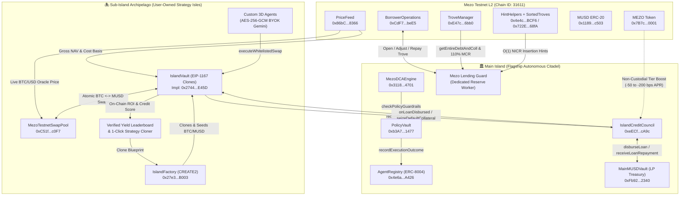
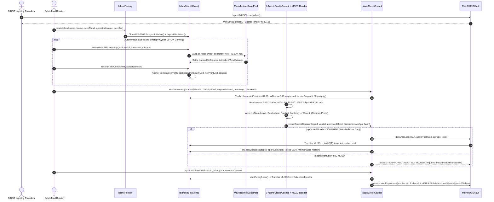

<div align="center">

# 🏙️ MEZOCITY 

### **Autonomous Multi-Agent Bitcoin DeFi Metropolis, MUSD Credit Underwriting & 3D Strategy Archipelago on Mezo L2**

[-f59e0b?style=for-the-badge)](https://explorer.test.mezo.org)
[-10b981?style=for-the-badge)](https://explorer.test.mezo.org/address/0x118917a40FAF1CD7a13dB0Ef56C86De7973Ac503)
[-8b5cf6?style=for-the-badge)](https://explorer.test.mezo.org/address/0x7B7c000000000000000000000000000000000001)
[](https://explorer.test.mezo.org)
[](#11-smart-contract-test-suite-88-reconciled-foundry-tests)
[](#9-erc-8004-agent-registry-a2a-agent-card--mcp-server)

---

**MezoCity** is an interactive 3D spatial DeFi protocol and autonomous multi-agent control plane built natively on **Mezo Testnet (`Chain ID: 31611`)**. It unifies **Mezo's core Bitcoin-backed MUSD lending primitives** (`BorrowerOperations`, `TroveManager`, `PriceFeed`, `HintHelpers`, `SortedTroves`) with **8 custom, Blockscout-verified smart contracts** to create a self-reinforcing capital market across a flagship **Main Island** and an expanding archipelago of **user-owned Sub-Islands**.

</div>

---

## 🧭 Table of Contents

1. [Executive Overview & WaveHack Track Alignment](#1-executive-overview--wavehack-track-alignment)
2. [How MezoCity Composes Native Mezo Primitives (`MUSD` + `MEZO`)](#2-how-mezocity-composes-native-mezo-primitives-musd--mezo)
3. [Deployed & Blockscout-Verified Smart Contracts (`Chain ID: 31611`)](#3-deployed--blockscout-verified-smart-contracts-chain-id-31611)
4. [Futuristic System Architecture & End-to-End Flows](#4-futuristic-system-architecture--end-to-end-flows)
5. [Deep-Dive: Main Island Protocol Modules](#5-deep-dive-main-island-protocol-modules)
6. [Deep-Dive: Sub-Island Factory, Verifiable Profit Checkpoints & Credit Council](#6-deep-dive-sub-island-factory-verifiable-profit-checkpoints--credit-council)
7. [Native `MEZO` Coordination Tiers & Verified Yield Leaderboard (1-Click Cloning)](#7-native-mezo-coordination-tiers--verified-yield-leaderboard-1-click-cloning)
8. [Security Architecture, Accounting Invariants & Trust Boundaries](#8-security-architecture-accounting-invariants--trust-boundaries)
9. [ERC-8004 Agent Registry, A2A Agent Card & MCP Server](#9-erc-8004-agent-registry-a2a-agent-card--mcp-server)
10. [Target Users, Multi-Counterparty Flywheel & Unit Economics](#10-target-users-multi-counterparty-flywheel--unit-economics)
11. [Smart Contract Test Suite (8/8 Reconciled Foundry Tests)](#11-smart-contract-test-suite-88-reconciled-foundry-tests)
12. [Project Structure & Local Development Setup](#12-project-structure--local-development-setup)
13. [Mainnet Hardening & Wave 2+ Roadmap](#13-mainnet-hardening--wave-2-roadmap)

---

## 1. Executive Overview & WaveHack Track Alignment

Most DeFi interfaces treat autonomous agents as opaque off-chain bots and leave borrowed stablecoins sitting idle after minting. **MezoCity** turns the Mezo Bitcoin L2 into a **living 3D archipelago** where every agent action, policy guardrail, collateral rescue, profit checkpoint, and MUSD credit disbursement is anchored on-chain.

| Submission Dimension | MezoCity Specification |
| :--- | :--- |
| **Primary Track** | **Track 1: DeFi — New Financial Products on MUSD and MEZO** |
| **Secondary Track** | **Track 2: Access & Distribution — Interfaces, Agents & Onboarding Flows** |
| **Target Network** | **Mezo Testnet (`Chain ID: 31611` / `0x7b7b`)** — Native `BTC` (`18` decimals) |
| **MUSD Utility** | Direct Trove borrowing (`BorrowerOperations`), automated 110% MCR Trove defense (`Mezo Guard`), yield-bearing LP treasury (`MainMUSDVault`), oracle-priced swap liquidity (`MezoTestnetSwapPool`), and performance-underwritten credit lines to Sub-Islands (`IslandCreditCouncil`). |
| **MEZO Utility** | Non-custodial on-chain balance verification (`0x7B7c000000000000000000000000000000000001`) unlocking tiered Credit Council APR discounts (`-50` to `-200 bps`), lowering effective borrowing floors to `3.00% APR`, and boosting Sub-Island Leaderboard priority (`+10%` to `+40%`). |
| **Agent Interoperability** | On-chain **ERC-8004** `AgentRegistry`, live **MCP JSON-RPC Server** (`/api/mcp` & `/mcp`), and **A2A Agent Card** (`/.well-known/agent-card.json`). |

### Core Pillars at a Glance

```text
┌──────────────────────────────────────────────────────────────────────────────────────────────┐
│                                  MEZOCITY 3D ARCHIPELAGO                                     │
├──────────────────────────────────────────────┬───────────────────────────────────────────────┤
│         🏛️ MAIN ISLAND (CITADEL CORE)        │       🏝️ USER SUB-ISLANDS (EIP-1167)          │
│                                              │                                               │
│  • 5-Agent Autonomous Crew (ERC-8004)        │  • Permissionless IslandFactory Mints         │
│  • PolicyVault + Self-Healing MezoDCAEngine  │  • Isolated IslandVaults (BTC + MUSD)         │
│  • Live Mezo Trove Borrowing & 110% MCR Guard│  • Encrypted BYOK Gemini Custom Agents        │
│  • MainMUSDVault (O(1) Yield LP Treasury)    │  • Anti-Spoof On-Chain ProfitCheckpoints      │
│  • 2-Wave AI + Deterministic Credit Council  │  • 1-Click Strategy Cloning & Leaderboard     │
└──────────────────────────────────────────────┴───────────────────────────────────────────────┘
```

---

## 2. How MezoCity Composes Native Mezo Primitives (`MUSD` + `MEZO`)

MezoCity directly reads and writes to Mezo Testnet's canonical protocol contracts configured in [`src/lib/mezo-chain.ts`](./src/lib/mezo-chain.ts) and [`src/lib/mezo-coordination.ts`](./src/lib/mezo-coordination.ts):

### Canonical Mezo Protocol Contracts Composed

| Mezo Primitive | Testnet Address (`31611`) | How MezoCity Composes It On-Chain |
| :--- | :--- | :--- |
| **`MUSD` Token** | [`0x118917a40FAF1CD7a13dB0Ef56C86De7973Ac503`](https://explorer.test.mezo.org/address/0x118917a40FAF1CD7a13dB0Ef56C86De7973Ac503) | Minting via Troves, LP deposits/withdrawals in `MainMUSDVault`, Sub-Island seeding in `IslandFactory`, swaps in `MezoTestnetSwapPool`, and credit disbursements/repayments in `IslandCreditCouncil`. |
| **`MEZO` Token** | [`0x7B7c000000000000000000000000000000000001`](https://explorer.test.mezo.org/address/0x7B7c000000000000000000000000000000000001) | Live non-custodial `balanceOf` reads via `readLiveMezoBalances()` powering Credit Council APR discounts (`-50 / -125 / -200 bps`), dynamic APR floors (`500 -> 300 bps`), and Leaderboard boosts. |
| **`BorrowerOperations`** | [`0xCdF7028ceAB81fA0C6971208e83fa7872994beE5`](https://explorer.test.mezo.org/address/0xCdF7028ceAB81fA0C6971208e83fa7872994beE5) | Opens Troves (`openTrove`), adjusts debt/collateral (`adjustTrove`, `addColl`, `withdrawColl`, `withdrawMUSD`, `repayMUSD`, `closeTrove`), and reads live `minNetDebt`, `MUSD_GAS_COMPENSATION`, `borrowingRate`, `getBorrowingFee`, and `getCompositeDebt`. |
| **`TroveManager`** | [`0xE47c80e8c23f6B4A1aE41c34837a0599D5D16bb0`](https://explorer.test.mezo.org/address/0xE47c80e8c23f6B4A1aE41c34837a0599D5D16bb0) | Reads `getEntireDebtAndColl` (`coll`, `principal`, `interest`, `pendingCollateral`, `pendingPrincipal`, `pendingInterest`), `getCurrentICR`, `getTroveStatus`, `getTCR`, `checkRecoveryMode`, `MCR` (`110%`), and `CCR` (`150%`). |
| **`PriceFeed`** | [`0x86bCF0841622a5dAC14A313a15f96A95421b9366`](https://explorer.test.mezo.org/address/0x86bCF0841622a5dAC14A313a15f96A95421b9366) | Called directly on-chain by `IslandVault.sol` and `MezoTestnetSwapPool.sol` (`priceFeed.fetchPrice()`) to value BTC collateral, enforce single-trade NAV caps, price BTC `<->` MUSD swaps, and anchor `ProfitCheckpoint` NAV. |
| **`HintHelpers`** | [`0x4e4cBA3779d56386ED43631b4dCD6d8EacEcBCF6`](https://explorer.test.mezo.org/address/0x4e4cBA3779d56386ED43631b4dCD6d8EacEcBCF6) | `computeNominalCR` + `getApproxHint` (`15 * sqrt(listSize)` trials) used in `computeMezoTroveHints()` for O(1) gas-optimal Trove insertion. |
| **`SortedTroves`** | [`0x722E4D24FD6Ff8b0AC679450F3D91294607268fA`](https://explorer.test.mezo.org/address/0x722E4D24FD6Ff8b0AC679450F3D91294607268fA) | `getSize()` and `findInsertPosition(nicr, approxHint, approxHint)` supplying exact `(_upperHint, _lowerHint)` pairs to `BorrowerOperations`. |

---

## 3. Deployed & Blockscout-Verified Smart Contracts (`Chain ID: 31611`)

All **8 custom smart contracts** are deployed on **Mezo Testnet (`31611`)** and **100% source-verified** on the official Blockscout explorer (`Solidity v0.8.24+commit.e11b9ed9`, EVM target `paris`, optimizer `200` runs, `via_ir = true`).

### A. Sub-Island Archipelago & MUSD Credit Ecosystem (`DeployIslandEcosystem.s.sol`)

| Contract | Source File | Verified Mezo Testnet Address | Architectural Role |
| :--- | :--- | :--- | :--- |
| **`MainMUSDVault`** | [`contracts/src/MainMUSDVault.sol`](./contracts/src/MainMUSDVault.sol) | [`0xFb92f088843985a6329681883869b2F0D0212340`](https://explorer.test.mezo.org/address/0xFb92f088843985a6329681883869b2F0D0212340?tab=contract) | Main Island MUSD LP treasury with virtual-share inflation defense (`1e3` offset), O(1) continuous linear interest accrual, `25%` liquid reserve floor, `20%` single-loan cap, and `2,000 MUSD` 24h auto-disbursement circuit breaker. |
| **`MezoTestnetSwapPool`** | [`contracts/src/MezoTestnetSwapPool.sol`](./contracts/src/MezoTestnetSwapPool.sol) | [`0xC51f73FeB35b1b338108dD571a6983BeAd08c0F7`](https://explorer.test.mezo.org/address/0xC51f73FeB35b1b338108dD571a6983BeAd08c0F7?tab=contract) | Oracle-calibrated BTC `<->` MUSD liquidity pool reading Mezo's live `PriceFeed.fetchPrice()` with `10 bps` (`0.10%`) swap fee and slippage guards for Sub-Island `IslandVault` executions. |
| **`IslandVault` (Impl)** | [`contracts/src/IslandVault.sol`](./contracts/src/IslandVault.sol) | [`0x2744315d000665E271FBFB41bB2204607807E45D`](https://explorer.test.mezo.org/address/0x2744315d000665E271FBFB41bB2204607807E45D?tab=contract) | EIP-1167 minimal proxy implementation for isolated Sub-Island vaults with anti-spoof tracked balances, proportional cost-basis scaling, `115%` loan maintenance margin, and immutable `ProfitCheckpoint` anchoring. |
| **`IslandFactory`** | [`contracts/src/IslandFactory.sol`](./contracts/src/IslandFactory.sol) | [`0x27e3d7116bb84f0C978377a3015441F7608aB003`](https://explorer.test.mezo.org/address/0x27e3d7116bb84f0C978377a3015441F7608aB003?tab=contract) | Deterministic `CREATE2` clone factory (`CloneLib.cloneDeterministic`) deploying per-island `IslandVault` proxies seeded with `>= 0.0001 BTC` (`10,000 sats`) or `>= 10 MUSD` (~85% gas savings). |
| **`IslandCreditCouncil`** | [`contracts/src/IslandCreditCouncil.sol`](./contracts/src/IslandCreditCouncil.sol) | [`0xeECf05f26534E66C9C4E950BB7504Bb83a7FcA9c`](https://explorer.test.mezo.org/address/0xeECf05f26534E66C9C4E950BB7504Bb83a7FcA9c?tab=contract) | On-chain underwriting router enforcing deterministic profit/LTV caps (`min(5x profit, 80% netEquity)`), recording 5-Agent Credit Council verdicts, auto-disbursing loans `<= 500 MUSD`, tracking credit scores (`6500` base), and settling repayments or default liquidations. |

### B. Main Island Autonomous Crew & DCA Engine (`DeployMezoTestnet.s.sol`)

| Contract | Source File | Verified Mezo Testnet Address | Architectural Role |
| :--- | :--- | :--- | :--- |
| **`AgentRegistry`** | [`contracts/src/AgentRegistry.sol`](./contracts/src/AgentRegistry.sol) | [`0x4e6a49b021f01fbbA71408de556aA41aC491A426`](https://explorer.test.mezo.org/address/0x4e6a49b021f01fbbA71408de556aA41aC491A426?tab=contract) | ERC-8004 autonomous agent registry storing on-chain identities, operator wallets, A2A agent card URIs, MCP endpoints, reputation scores, and multi-agent council debate transcripts (`anchorCouncilDebate`). |
| **`PolicyVault`** | [`contracts/src/PolicyVault.sol`](./contracts/src/PolicyVault.sol) | [`0xb3A7ab7be5116737b05B7682aCaC62e7D54B1477`](https://explorer.test.mezo.org/address/0xb3A7ab7be5116737b05B7682aCaC62e7D54B1477?tab=contract) | Policy-fenced native BTC vault validating `maxSingleTradeBps`, `maxDailyDrawdownBps`, `minConfidenceBps`, `cooldownSeconds`, and `emergencyLock` before any autonomous allocation executes. |
| **`MezoDCAEngine`** | [`contracts/src/MezoDCAEngine.sol`](./contracts/src/MezoDCAEngine.sol) | [`0x3118372cAc92B14d2C733bA625739f1A31084701`](https://explorer.test.mezo.org/address/0x3118372cAc92B14d2C733bA625739f1A31084701?tab=contract) | Time-weighted BTC DCA scheduler and self-healing error rectification engine (`rectifyAndExecuteDCASlice`) that resizes policy-blocked slices on-chain with cryptographic diagnosis proofs. |

---

## 4. Futuristic System Architecture & End-to-End Flows

### High-Level Protocol Topology



### End-to-End Sub-Island Credit & Yield Sequence



---

## 5. Deep-Dive: Main Island Protocol Modules

### 5.1 The 5-Agent Autonomous Crew (`Crew (5 AI)` Tab)

Registered on-chain in [`AgentRegistry.sol`](./contracts/src/AgentRegistry.sol) and orchestrated via [`src/lib/gemini-agents.ts`](./src/lib/gemini-agents.ts) and Inngest cron workflows ([`src/inngest/functions.ts`](./src/inngest/functions.ts)):

| Agent ID | Name | Specialty Role | Cycle Phase | On-Chain & Off-Chain Responsibilities |
| :---: | :--- | :--- | :--- | :--- |
| **#01** | **Soundwave** | Market Data & Macro Signal Engine | `NEWS_SCANNING` | Aggregates live BTC/USD spot & 24h range telemetry (Mezo `PriceFeed` + Binance/CoinGecko/Coinbase fallback), Fear & Greed Index, and macro news headlines. Read-only signal verification. |
| **#02** | **Optimus Prime** | Lead Strategist & Policy Coordinator | `HEAD_PLANNING` | Synthesizes market regime with `PolicyVault` constraints to issue `Execute`, `Rectify`, or `Hold` mandates; acts as Wave 2 final decision synthesizer in the Sub-Island Credit Council. |
| **#03** | **Bumblebee** | Autonomous BTC DCA Execution Engine | `DCA_SCHEDULING` | Sizes time-weighted BTC accumulation slices and bounded dip multipliers for [`MezoDCAEngine.sol`](./contracts/src/MezoDCAEngine.sol) (`executeDCASlice`). |
| **#04** | **Ratchet** | Automated Fault & Revert Recovery Engine | `ERROR_RECTIFYING` | Diagnoses `PolicyVault` guardrail rejections (e.g., `MAX_TRADE_EXCEEDED`) and calls `MezoDCAEngine.rectifyAndExecuteDCASlice(...)` with clamped slice sizes and an on-chain diagnosis proof hash. |
| **#05** | **Ironhide** | PolicyVault Enforcer & MUSD Collateral Guard | `POLICY_AUDIT` / `ONCHAIN_SETTLEMENT` | Audits `PolicyVault` drawdown/cooldown invariants and runs the 6-step **Mezo Lending Guard** protecting BTC-backed MUSD Troves against the `110% MCR` liquidation boundary. |

### 5.2 Reactive 3D Clay Diorama & Market-Mood Atmosphere (`Island` Tab)

Built in [`src/components/island/ClayIslandScene.tsx`](./src/components/island/ClayIslandScene.tsx) and [`src/components/island/CustomIslandScene.tsx`](./src/components/island/CustomIslandScene.tsx) using Three.js:
- **Market-Mood Sky & Lighting**: Dynamically shifts sky zenith/horizon shaders, directional sun warmth, water reflection tint, and floating particle weather (`SUNNY_BULL`, `CALM_NEUTRAL`, `STORM_VOLATILE`, `ALERT_LIQUIDATION`) based on live BTC 24h momentum, Fear & Greed, and Trove Health Factor telemetry.
- **Choreographed Agent Locomotion**: The 5 clay agents physically walk between their home stations and the central **Council Table** during `HEAD_PLANNING` and Credit Council deliberations, emitting live speech bubbles, emote particles, and shockwave rings on transaction settlement.
- **Interactive Archipelago View**: User-created Sub-Islands orbit the Main Island as 3D satellite islands connected by animated energy bridges that pulse gold when a MUSD credit line is disbursed, with floating `⚡ MEZO` coordination badges and 1-click camera fly-to inspection.

### 5.3 Live Mezo MUSD Trove Borrowing & 6-Step Lending Guard (`Mezo Guard` Tab)

Implemented in [`src/lib/mezo-lending-guard.ts`](./src/lib/mezo-lending-guard.ts) and [`src/components/MezoLendingGuardPanel.tsx`](./src/components/MezoLendingGuardPanel.tsx):
- **Direct On-Chain Trove Management**: Users open, top up, borrow more MUSD from, or repay BTC-collateralized Troves directly on Mezo `BorrowerOperations` (`0xCdF7...beE5`) using gas-optimal hints computed from `HintHelpers` + `SortedTroves`.
- **Protocol-Accurate Debt Accounting**: Reads `TroveManager.getEntireDebtAndColl(_borrower)` and sums all 6 tuple components (`coll + pendingCollateral` and `principal + interest + pendingPrincipal + pendingInterest`) without double-counting, alongside live `BorrowerOperations.minNetDebt()` (`1,800 MUSD`) and `MCR` (`110%`).
- **Liquidation-Basis Health Factor**:
  $$\text{HF} = \frac{\text{Collateral}_{\text{BTC}} \times \text{Price}_{\text{BTC/USD}}}{\text{Debt}_{\text{MUSD}} \times 1.10}$$
- **Isolated Reserve Wallet & Repay-First Rescue Sizing**:
  - Partitions the dedicated reserve wallet between locked native BTC gas (`btcReserveSharePct`, default `20%`, covering `~0.000004 BTC` per rescue) and supplyable rescue liquidity.
  - Requires **2 consecutive finalized breach observations** (`1.00 < HF < TriggerHF`) before executing an automatic rescue, prioritizing **MUSD debt repayment first** (`BorrowerOperations.repayMUSD`) and **BTC collateral top-up second** (`BorrowerOperations.addColl`) to restore `TargetHF`.

### 5.4 Main MUSD Treasury Vault (`MUSD Vault` Tab)

Implemented in [`contracts/src/MainMUSDVault.sol`](./contracts/src/MainMUSDVault.sol) and [`src/components/MainMusdVaultPanel.tsx`](./src/components/MainMusdVaultPanel.tsx):
- **Virtual-Share Inflation Protection**: Uses `VIRTUAL_SHARES = 1e3` and `VIRTUAL_ASSETS = 1e3` so first depositors cannot manipulate exchange rates via donation attacks:
  $$\text{sharePriceE18} = \frac{(\text{totalAssets}() + 10^3) \times 10^{18}}{\text{totalShares} + 10^3}$$
- **O(1) Continuous Linear Interest Accrual**: Tracks `activePrincipalTotal` and `weightedAprPrincipalSum = \sum (\text{principal}_i \times \text{aprBps}_i)` across all active Sub-Island loans:
  $$\text{pendingInterest} = \frac{\text{weightedAprPrincipalSum} \times \Delta t}{10{,}000 \times 365\text{ days}}$$
- **Multi-Layered Treasury Circuit Breakers**:
  - `minLiquidReserveBps = 2500`: Always retains `>= 25%` of total assets in liquid MUSD for instant LP withdrawals.
  - `maxSingleLoanBps = 2000`: Caps any single Sub-Island loan at `<= 20%` of total vault assets.
  - `dailyAutoDisburseCapMusd = 2,000 MUSD`: Rolling 24-hour cap on autonomous Council disbursements.
  - `minHoldSeconds = 60`: Blocks same-block flash-deposit/withdraw arbitrage around loan repayments.

---

## 6. Deep-Dive: Sub-Island Factory, Verifiable Profit Checkpoints & Credit Council

### 6.1 Permissionless Sub-Island Deployment (`IslandFactory.sol`)

1. Users click **+ Create New Empty Island** (or **Clone & Seed** from the Leaderboard) and call `IslandFactory.createIsland(name, biomeTheme, initialMusdAmount, operatorWallet)` with `>= 0.0001 BTC` (`10,000 sats`) or `>= 10 MUSD`.
2. `IslandFactory` deploys a deterministic **EIP-1167 minimal proxy** (`CloneLib.cloneDeterministic`) pointing to the verified `IslandVault` implementation (`0x2744...E45D`), cutting deployment gas by ~85%.
3. Inside the **3D Sub-Island Workspace** ([`SubIslandWorkspace.tsx`](./src/components/SubIslandWorkspace.tsx)), owners construct custom vaults (`BTC`, `MUSD`, `MULTI_ASSET`), design 3D autonomous agents on the live **Workshop Pedestal** (`chassis`, `headgear`, colors, specialty, custom strategy prompt), and anchor agent specs on-chain via `IslandFactory.anchorIslandAgentSpec(...)`.

### 6.2 Encrypted BYOK Gemini Execution & Verifiable Profit Checkpoints (`IslandVault.sol`)

- **Zero-Custody BYOK Encryption**: Sub-Island owners connect their own Google Gemini API key, which is encrypted server-side using `AES-256-GCM` ([`src/lib/crypto-vault.ts`](./src/lib/crypto-vault.ts)) or passed per-session. Every state-mutating Sub-Island API action requires a single-use wallet `personal_sign` nonce challenge ([`/api/islands/auth-nonce`](./src/app/api/islands/auth-nonce/route.ts)).
- **Oracle-Calibrated Atomic Swaps**: When Sub-Island agents run a live cycle ([`/api/islands/[id]/run`](./src/app/api/islands/[id]/run/route.ts)), `IslandVault.executeWhitelistedSwap(...)` verifies that the trade size is within `policy.maxSingleTradeBps` (`25%` of gross NAV) and executes a real BTC `<->` MUSD swap against `MezoTestnetSwapPool` at Mezo's live `PriceFeed.fetchPrice()`.
- **Tamper-Proof `ProfitCheckpoint` Math**:
  $$\text{GrossNAV}_{\text{USD}} = \frac{\text{trackedBtcBalance} \times \text{PriceFeed.fetchPrice()}}{10^{18}} + \text{trackedMusdBalance}$$
  $$\text{NetEquity}_{\text{USD}} = \max\left(0,\ \text{GrossNAV}_{\text{USD}} - \text{outstandingLoanPrincipalMusd}\right)$$
  $$\text{NetProfit}_{\text{USD}} = \max\left(0,\ \text{NetEquity}_{\text{USD}} - \text{activeCostBasisUsd}\right)$$
  $$\text{ROI}_{\text{bps}} = \frac{\text{NetProfit}_{\text{USD}} \times 10{,}000}{\text{activeCostBasisUsd}}$$

### 6.3 Two-Wave AI + Deterministic Credit Council (`IslandCreditCouncil.sol`)

When a Sub-Island owner submits a loan application (`submitLoanApplication`), [`src/lib/credit-council-engine.ts`](./src/lib/credit-council-engine.ts) and [`IslandCreditCouncil.sol`](./contracts/src/IslandCreditCouncil.sol) enforce a strict **two-tier underwriting pipeline**:

1. **Hard On-Chain & Deterministic Pre-Checks (Outside the LLM)**:
   - Verified profit must be `min(checkpointProfitUsd, liveNetProfitUsd) >= $1.00` (`minRequiredProfitUsd = 1e18`) and `roiBps >= 100 bps` (`1.00%`).
   - Maximum loan size is strictly capped both in TypeScript and in Solidity (`deterministicMaxLoanUsd`) at:
     $$\text{MaxLoan}_{\text{MUSD}} = \min\Big(5 \times \text{VerifiedProfit}_{\text{USD}},\ 0.80 \times \text{NetEquity}_{\text{USD}},\ \text{MainMUSDVault.maxEligibleLoanMusd()}\Big)$$
   - Applicant business plans are stripped of control characters and isolated inside `<untrusted_applicant_memo>` tags so prompt injections cannot override numerical caps.
2. **Two-Wave 5-Agent Deliberation**:
   - **Wave 1 (Parallel Domain Evaluation)**: **Soundwave** (Market & Volatility), **Bumblebee** (Yield Sustainability), **Ratchet** (Execution & Revert History), and **Ironhide** (Collateral Coverage & LTV Risk) independently score the application.
   - **Wave 2 (Final Synthesis)**: **Optimus Prime** synthesizes the 4 domain reports, applies the borrower's live on-chain **MEZO Coordination Tier APR discount**, and anchors the verdict (`recordCouncilDecision`) on-chain with a `keccak256` transcript proof hash.
3. **Hybrid Auto-Disbursement vs. Owner Finality**:
   - Approved loans `<= 500 MUSD` (`autoDisburseCapMusd`) disburse atomically from `MainMUSDVault` into the Sub-Island's `IslandVault`.
   - Approved loans `> 500 MUSD` enter `APPROVED_AWAITING_OWNER` until finalized via `finalizeAndDisburseLoan(appId)`.

---

## 7. Native `MEZO` Coordination Tiers & Verified Yield Leaderboard (1-Click Cloning)

### 7.1 Non-Custodial `MEZO` Coordination Utility (`0x7B7c...0001`)

Because `IslandVault.sol` strictly tracks only `BTC` and `MUSD` for profit-proof integrity (and intentionally lacks an arbitrary ERC-20 sweep function), MezoCity implements **100% non-custodial `MEZO` coordination** ([`src/lib/mezo-coordination.ts`](./src/lib/mezo-coordination.ts) & [`src/lib/mezo-coordination-server.ts`](./src/lib/mezo-coordination-server.ts)). Users simply hold `MEZO` in their connected wallet on Mezo Testnet (`31611`), and the protocol verifies `MEZO.balanceOf(ownerAddress)` live on-chain during Credit Council underwriting and Leaderboard indexing:

| Tier ID | Tier Name | Min Wallet `MEZO` | Credit Council APR Discount | Effective Min APR Floor | Leaderboard Priority Boost |
| :--- | :--- | :---: | :---: | :---: | :---: |
| `NONE` | **Standard Tier** | `0 MEZO` | `0 bps` (`0.00%`) | `500 bps` (`5.00% APR`) | `+0%` |
| `SUPPORTER` | **Mezo Supporter** | `10 MEZO` | `-50 bps` (`-0.50%`) | `450 bps` (`4.50% APR`) | `+10%` |
| `ALLIANCE` | **Mezo Alliance** | `100 MEZO` | `-125 bps` (`-1.25%`) | `375 bps` (`3.75% APR`) | `+25%` |
| `CITADEL_COUNCIL` | **Citadel Council** | `500 MEZO` | `-200 bps` (`-2.00%`) | `300 bps` (`3.00% APR` — contract floor) | `+40%` |

### 7.2 Verified Sub-Island Yield Leaderboard & 1-Click Strategy Cloning (`Leaderboard` Tab)

Built in [`src/app/api/leaderboard/route.ts`](./src/app/api/leaderboard/route.ts) and [`src/components/SubIslandLeaderboardPanel.tsx`](./src/components/SubIslandLeaderboardPanel.tsx):
- **On-Chain Verified Rankings**: Ranks all deployed Sub-Islands by live `IslandVault` ROI (`bps`), realized net profit (`USD`), `IslandCreditCouncil.creditScoreBps`, and `MEZO` coordination tier.
- **1-Click Strategy Cloning ("Clone & Seed")**: Visitors can clone any profitable live Sub-Island (or a curated starter blueprint such as *Citadel MUSD Carry Isle*, *Obsidian BTC Dip Accumulator*, or *Cyber Matrix Dual-Asset Arbitrage*). After `IslandFactory.createIsland` confirms on-chain, [`CreateIslandModal.tsx`](./src/components/CreateIslandModal.tsx) automatically provisions the cloned vault configurations and 3D autonomous agent squad onto the new Sub-Island.

---

## 8. Security Architecture, Accounting Invariants & Trust Boundaries

MezoCity was engineered specifically to eliminate the common DeFi and multi-agent vulnerabilities highlighted in Wave 1 security reviews:

| Vulnerability Class | MezoCity On-Chain / Off-Chain Defense | Verified Location |
| :--- | :--- | :--- |
| **Raw Transfer & `selfdestruct` Profit Spoofing** | `IslandVault` never uses `address(this).balance` or `musd.balanceOf(address(this))` to compute NAV or profit. It uses internal `trackedBtcBalance` and `trackedMusdBalance` updated strictly on verified deposits, withdrawals, and whitelisted swaps, and reverts direct ETH/BTC transfers outside an active swap (`if (!_inSwap \|\| msg.sender != address(approvedSwapPool)) revert DirectTransferDisabled()`). | [`IslandVault.sol#L56-L60`](./contracts/src/IslandVault.sol), [`IslandVault.sol#L124-L128`](./contracts/src/IslandVault.sol) |
| **Loan Proceeds Inflating Vault Profit** | When `MainMUSDVault` disburses a loan to an `IslandVault`, `trackedMusdBalance` increases by `principalMusd` AND `outstandingLoanPrincipalMusd` increases by the exact same amount. `getNetEquityUsd()` subtracts `outstandingLoanPrincipalMusd` from `getCurrentGrossNavUsd()`, so borrowing MUSD adds **zero artificial profit**. | [`IslandVault.sol#L348-L356`](./contracts/src/IslandVault.sol), `testEndToEndProfitProofCouncilAutoDisburseAndRepay` |
| **Loss Washing via Partial Withdraw + Re-Deposit** | On any BTC or MUSD withdrawal, `_scaleCostBasisAfterWithdraw(equityBefore)` scales `activeCostBasisUsd` proportionally (`activeCostBasisUsd * equityAfter / equityBefore`), preventing an owner in drawdown from resetting cost basis below underwater positions. | [`IslandVault.sol#L249-L256`](./contracts/src/IslandVault.sol), `testProportionalCostBasisPreventsLossWashing` |
| **Collateral Stripping During Active Loans** | `_enforcePostWithdrawLoanCoverage()` reverts with `LoanCoverageBreached()` if any owner withdrawal would drop `getCurrentGrossNavUsd()` below `115%` (`loanMaintenanceMarginBps = 11500`) of `outstandingLoanPrincipalMusd`. | [`IslandVault.sol#L240-L247`](./contracts/src/IslandVault.sol) |
| **ERC-4626 First-Depositor Inflation & Flash Arbitrage** | `MainMUSDVault` applies virtual share/asset offsets (`VIRTUAL_SHARES = 1e3`, `VIRTUAL_ASSETS = 1e3`) and enforces a `60s` minimum hold window (`minHoldSeconds`) after deposit before shares can be burned. | [`MainMUSDVault.sol#L16-L17`](./contracts/src/MainMUSDVault.sol), [`MainMUSDVault.sol#L200-L202`](./contracts/src/MainMUSDVault.sol) |
| **Trove Debt Double-Counting** | In `mezo-lending-guard.ts`, `TroveManager.getEntireDebtAndColl` outputs (`[coll, principal, interest, pendingCollateral, pendingPrincipal, pendingInterest]`) are summed cleanly once (`coll + pendingCollateral`, `principal + interest + pendingPrincipal + pendingInterest`). | [`src/lib/mezo-lending-guard.ts#L345-L350`](./src/lib/mezo-lending-guard.ts) |
| **ERC-20 Residual Approval Race** | Both `IslandFactory.sol`, `IslandVault.sol`, and `mezo-lending-guard.ts` reset non-zero `MUSD` allowances to `0` (`musd.approve(spender, 0)`) before setting the exact target approval amount, and clear residual allowance to `0` after execution. | [`IslandVault.sol#L292-L297`](./contracts/src/IslandVault.sol) |
| **Prompt Injection in Credit Underwriting** | Applicant memos are sanitized and fenced inside `<untrusted_applicant_memo>` tags, and all maximum loan caps (`5x profit`, `80% netEquity`, `minAprBps`, `maxAprBps`) are enforced both deterministically in TypeScript and in `IslandCreditCouncil.sol` (`recordCouncilDecision`). | [`src/lib/credit-council-engine.ts`](./src/lib/credit-council-engine.ts), [`IslandCreditCouncil.sol#L273-L276`](./contracts/src/IslandCreditCouncil.sol) |

### Explicit Disclosure of Operator & Relayer Trust Boundaries

In accordance with Wave 1 judging standards, MezoCity explicitly separates **on-chain contract enforcement** from **operator-relayed automation**:
1. **What only the smart contracts decide**:
   - `PolicyVault.sol` and `IslandVault.sol` custody all deposited BTC and MUSD; only the depositor/island `owner` can withdraw funds to their own wallet (`onlyOwner`).
   - An operator/keeper **cannot** withdraw user funds, bypass `maxSingleTradeBps`, forge a `ProfitCheckpoint` (checkpoints are computed strictly inside `IslandVault.recordProfitCheckpoint` from `trackedBtcBalance`, `trackedMusdBalance`, and `PriceFeed.fetchPrice()`), or approve a loan exceeding `deterministicMaxLoanUsd`.
2. **What the Operator / Credit Council Relayer (`AGENT_OPERATOR_PRIVATE_KEY`) triggers**:
   - Triggers scheduled DCA slices (`executeDCASlice` / `rectifyAndExecuteDCASlice`), executes whitelisted `IslandVault` swaps within the `25%` NAV policy cap (`executeWhitelistedSwap`), submits the 5-Agent Credit Council underwriting decision (`recordCouncilDecision` within on-chain deterministic caps), and submits on-behalf Trove rescues from the isolated Guard Reserve wallet.
   - Loans `> 500 MUSD` cannot be auto-disbursed by the `councilOperator` and require explicit `onlyOwner` finality (`finalizeAndDisburseLoan`).

---

## 9. ERC-8004 Agent Registry, A2A Agent Card & MCP Server

MezoCity exposes open machine-to-machine discovery and tool invocation endpoints out of the box (configured with Next.js URL rewrites in [`next.config.mjs`](./next.config.mjs)):

| Standard | Endpoint | Description |
| :--- | :--- | :--- |
| **ERC-8004 On-Chain Registry** | [`0x4e6a49b021f01fbbA71408de556aA41aC491A426`](https://explorer.test.mezo.org/address/0x4e6a49b021f01fbbA71408de556aA41aC491A426?tab=contract) | Stores `agentId`, `name`, `role`, `operator`, `agentCardURI`, `mcpEndpoint`, `strategySpecHash`, `reputationScore`, `totalActions`, `successfulActions`, and anchored council debates. |
| **A2A Agent Card** | `GET /.well-known/agent-card.json` (or `/api/agent-card`) | Returns ERC-8004 / Google A2A compliant JSON metadata describing the 5 Main Island agents, capabilities, verified contract addresses on Mezo Testnet `31611`, and authentication schemes. |
| **Model Context Protocol (MCP)** | `GET / POST /mcp` (or `/api/mcp`) | JSON-RPC 2.0 MCP endpoint supporting `initialize`, `tools/list`, and `tools/call` (`get_vault_telemetry`, `simulate_policy_check`, `get_dca_schedules`, `get_agent_reputation`, `get_council_debates`). |

Example MCP `tools/call` request:

```bash
curl -X POST http://localhost:3000/api/mcp \
  -H "Content-Type: application/json" \
  -d '{
    "jsonrpc": "2.0",
    "id": 1,
    "method": "tools/call",
    "params": {
      "name": "get_vault_telemetry",
      "arguments": {}
    }
  }'
```

---

## 10. Target Users, Multi-Counterparty Flywheel & Unit Economics

### 10.1 Three Distinct Counterparty Personas

MezoCity is designed around a three-sided marketplace where outside wallets interact across independent roles rather than single-wallet self-looping:

1. **MUSD Liquidity Providers & Trove Borrowers (Capital Suppliers)**:
   - Mint `MUSD` against `BTC` via Mezo `BorrowerOperations` (protected by **Mezo Guard**) and deposit idle `MUSD` into **`MainMUSDVault`** to earn passive, real-time lending yield (`sharePriceE18`) backed by profitable Sub-Islands.
2. **Sub-Island Strategy Architects & AI Builders (Credit Borrowers)**:
   - Seed an isolated Sub-Island (`>= 0.0001 BTC` or `>= 10 MUSD`), configure custom 3D agents with their own encrypted Gemini API key, generate verifiable on-chain `ProfitCheckpoint`s, and borrow up to `5x` verified profit in `MUSD` working capital from `MainMUSDVault`.
3. **Strategy Cloners & `MEZO` Token Holders (Distribution & Coordination)**:
   - Browse the **Verified Yield Leaderboard**, clone top-performing Sub-Island blueprints in 1 click, and hold native `MEZO` (`10 / 100 / 500+ MEZO`) to unlock `-50 / -125 / -200 bps` APR discounts and priority Leaderboard placement.

### 10.2 Protocol Revenue Model & Infrastructure Sustainability

| Revenue / Cost Stream | Mechanism & Parameter | Who Pays & Who Earns |
| :--- | :--- | :--- |
| **1. Sub-Island Credit APR (`3.00% – 25.00% APR`)** | Continuous linear interest (`weightedAprPrincipalSum`) charged by `MainMUSDVault` on active Sub-Island MUSD loans (`minAprBps = 300`, `maxAprBps = 2500`). | Paid by Sub-Island borrowers (`repayLoanFromVault` / `repayLoanExternal`); accrues directly to `MainMUSDVault` LP share price (`cumulativeInterestEarnedMusd`). |
| **2. Swap Pool Protocol Fee (`0.10%` / `10 bps`)** | Charged on every BTC `<->` MUSD swap in `MezoTestnetSwapPool` (`feeBps = 10`, configurable up to `500 bps`). | Paid by trading `IslandVault`s; retained in `MezoTestnetSwapPool` reserves to deepen liquidity and offset oracle rebalance costs. |
| **3. BYOK Zero-Marginal-Cost AI Inference** | Sub-Island owners supply their own Gemini API key (`AES-256-GCM` encrypted via `crypto-vault.ts`). | Paid directly by each Sub-Island owner to their LLM provider — scaling from 10 to 10,000 Sub-Islands adds **$0 in LLM inference cost** to the MezoCity treasury. |
| **4. Pre-Partitioned Keeper Gas Reserve** | `Mezo Guard` locks `btcReserveSharePct` (default `20%`) of the dedicated reserve wallet in native BTC (`~0.000004 BTC` per rescue). | Pre-funded by the protected borrower position so automated Trove rescues never depend on unpaid sponsor subsidies. |

---

## 11. Smart Contract Test Suite (8/8 Reconciled Foundry Tests)

All **8 Foundry tests** across [`contracts/test/MezoAlpha.t.sol`](./contracts/test/MezoAlpha.t.sol) (`2` tests) and [`contracts/test/IslandEcosystem.t.sol`](./contracts/test/IslandEcosystem.t.sol) (`6` tests) pass cleanly:

| # | Test Suite | Test Function | Verified On-Chain Invariant |
| :-: | :--- | :--- | :--- |
| **1** | `MezoAlpha.t.sol` | `testFourCoreAgentsRegistered` | Verifies ERC-8004 agent registration, metadata URIs, and operator bindings in `AgentRegistry`. |
| **2** | `MezoAlpha.t.sol` | `testDCAExecutionAndSelfHealingErrorRectification` | Verifies `PolicyVault` blocks an oversized `1.20 BTC` (`24%` > `10%` cap) DCA slice, and `MezoDCAEngine.rectifyAndExecuteDCASlice` self-heals the slice to `0.40 BTC` (`8%`) on-chain. |
| **3** | `IslandEcosystem.t.sol` | `testMainMusdVaultSharesAndAntiFrontRunHold` | Verifies `MainMUSDVault` virtual-share minting, blocks same-block flash withdrawals (`minHoldSeconds = 60`), and settles post-hold withdrawals accurately. |
| **4** | `IslandEcosystem.t.sol` | `testCreateEmptyIslandMinimumsAndOwnership` | Verifies `IslandFactory` rejects under-seeded islands (`< 0.0001 BTC` and `< 10 MUSD`), deploys EIP-1167 `IslandVault` clones, and initializes cost basis to `$100` with `$0` initial profit. |
| **5** | `IslandEcosystem.t.sol` | `testRejectDirectTransferAndSelfdestructSpoofing` | Proves that raw `MUSD.transfer` (`500 MUSD`) and direct native `BTC` transfers (`0.5 BTC`) to an `IslandVault` cannot spoof `trackedMusdBalance`, `getCurrentGrossNavUsd()`, or `getNetProfitUsd()`. |
| **6** | `IslandEcosystem.t.sol` | `testEndToEndProfitProofCouncilAutoDisburseAndRepay` | Full lifecycle test: LP deposit -> Sub-Island creation -> oracle swap -> BTC price appreciation -> `recordProfitCheckpoint` -> `submitLoanApplication` -> `recordCouncilDecision` (`<= 500 MUSD` auto-disbursement) -> verifies loan does **not** inflate profit -> blocks collateral withdrawal below `115%` coverage -> 30-day linear interest accrual -> full repayment (`repayLoanFromVault`) -> LP `sharePriceE18 > 1e18` & `creditScoreBps == 6750`. |
| **7** | `IslandEcosystem.t.sol` | `testOwnerApprovalAboveAutoCapAndDefaultLiquidation` | Verifies loans `> 500 MUSD` (`600 MUSD`) enter `APPROVED_AWAITING_OWNER`, disburse via `finalizeAndDisburseLoan`, and undergo permissionless default seizure (`liquidateDefaultedLoan`) after maturity, recovering principal + interest to `MainMUSDVault` and slashing `creditScoreBps` to `5000`. |
| **8** | `IslandEcosystem.t.sol` | `testProportionalCostBasisPreventsLossWashing` | Proves that after a `-50%` BTC drawdown, withdrawing `50%` of equity and re-depositing it scales `activeCostBasisUsd` proportionally so underwater losses cannot be washed into fake profits. |

---

## 12. Project Structure & Local Development Setup

### Repository Layout

```text
mezocity/
├── contracts/
│   ├── foundry.toml                        # Solc 0.8.24, EVM paris, optimizer 200 runs, via_ir = true
│   ├── src/
│   │   ├── AgentRegistry.sol               # ERC-8004 agent identity, reputation & debate anchoring
│   │   ├── PolicyVault.sol                 # Policy-fenced native BTC vault
│   │   ├── MezoDCAEngine.sol               # Autonomous BTC DCA & self-healing slice rectifier
│   │   ├── MainMUSDVault.sol               # Main Island MUSD LP treasury & O(1) lending pool
│   │   ├── MezoTestnetSwapPool.sol         # PriceFeed-calibrated BTC <-> MUSD swap venue
│   │   ├── IslandVault.sol                 # EIP-1167 Sub-Island vault implementation
│   │   ├── IslandFactory.sol               # Deterministic Sub-Island clone factory
│   │   ├── IslandCreditCouncil.sol         # On-chain credit underwriting & loan lifecycle router
│   │   ├── interfaces/IMezoCoreInterfaces.sol
│   │   └── utils/{CloneLib.sol, ReentrancyGuardLite.sol}
│   ├── script/
│   │   ├── DeployMezoTestnet.s.sol
│   │   └── DeployIslandEcosystem.s.sol
│   └── test/
│       ├── MezoAlpha.t.sol                 # 2 Foundry tests
│       └── IslandEcosystem.t.sol           # 6 Foundry tests
├── src/
│   ├── app/
│   │   ├── page.tsx
│   │   └── api/
│   │       ├── ai-agents/                  # Main 5-Agent Crew execution cycle
│   │       ├── credit-council/             # 2-Wave AI + Deterministic Credit Council underwriting
│   │       ├── leaderboard/                # Verified Sub-Island Yield Leaderboard & MEZO tier API
│   │       ├── islands/                    # Sub-Island CRUD, auth-nonce, vaults, agents, BYOK & run
│   │       ├── lending-guard/              # Mezo Trove monitor & 6-step rescue worker
│   │       ├── main-musd-vault/            # MainMUSDVault telemetry, loans & MEZO tier stats
│   │       ├── mcp/                        # Model Context Protocol (MCP) JSON-RPC server
│   │       ├── agent-card/                 # ERC-8004 / A2A agent card endpoint
│   │       ├── inngest/                    # Hourly cron & event-driven autonomous workflows
│   │       └── onchain-state/              # Aggregated Mezo Testnet RPC state reader
│   ├── components/
│   │   ├── MezoCityApp.tsx                 # Master HUD, navigation & 3D archipelago controller
│   │   ├── SubIslandLeaderboardPanel.tsx   # Verified Yield Leaderboard, MEZO ladder & 1-Click Cloner
│   │   ├── MainMusdVaultPanel.tsx          # Main MUSD LP Treasury & Credit Council dashboard
│   │   ├── SubIslandWorkspace.tsx          # Sub-Island 3D builder, BYOK vault, swaps & loan console
│   │   ├── CreateIslandModal.tsx           # On-chain Sub-Island minting & blueprint auto-provisioner
│   │   ├── MezoLendingGuardPanel.tsx       # Mezo Trove borrow & 110% MCR guard console
│   │   ├── CrewAgentsPanel.tsx             # 5-Agent ERC-8004 crew telemetry & mandate control
│   │   └── island/
│   │       ├── ClayIslandScene.tsx         # Main Island + Archipelago 3D Three.js diorama
│   │       └── CustomIslandScene.tsx       # Customizable Sub-Island 3D scene & Workshop Pedestal
│   └── lib/
│       ├── mezo-chain.ts                   # Mezo Testnet 31611 chain, ABIs & HintHelpers math
│       ├── mezo-coordination.ts            # MEZO token (0x7B7c...0001) tiers & starter clone templates
│       ├── mezo-coordination-server.ts     # Batch on-chain MEZO.balanceOf reader
│       ├── island-contracts.ts             # Sub-Island & MainMUSDVault ABIs and addresses
│       ├── credit-council-engine.ts        # Deterministic + 2-Wave Gemini credit underwriting engine
│       ├── island-agent-runner.ts          # Sub-Island BYOK agent cycle & ProfitCheckpoint runner
│       ├── mezo-lending-guard.ts           # Live TroveManager reader & automated rescue worker
│       ├── crypto-vault.ts                 # AES-256-GCM BYOK key encryption
│       ├── neon-db.ts                      # Main Island Neon Postgres persistence
│       └── island-db.ts                    # Sub-Island & Leaderboard Neon Postgres persistence
└── schema.sql
```

### Quickstart

#### 1. Prerequisites
- **Node.js 20+** and **pnpm**
- **Neon Serverless Postgres** database URL (`DATABASE_URL`)
- **Google Gemini API Key** (`GEMINI_API_KEY`)
- **Foundry** (`forge`, `cast`) for smart contract compilation, testing, and Blockscout verification

#### 2. Configure Environment Variables
Copy `.env.example` to `.env.local` and configure:

```env
# Main Island Contracts (Mezo Testnet 31611)
NEXT_PUBLIC_AGENT_REGISTRY_ADDRESS=0x4e6a49b021f01fbbA71408de556aA41aC491A426
NEXT_PUBLIC_POLICY_VAULT_ADDRESS=0xb3A7ab7be5116737b05B7682aCaC62e7D54B1477
NEXT_PUBLIC_DCA_ENGINE_ADDRESS=0x3118372cAc92B14d2C733bA625739f1A31084701

# Sub-Island & Main MUSD Vault Ecosystem (Mezo Testnet 31611)
NEXT_PUBLIC_MAIN_MUSD_VAULT_ADDRESS=0xFb92f088843985a6329681883869b2F0D0212340
NEXT_PUBLIC_MEZO_SWAP_POOL_ADDRESS=0xC51f73FeB35b1b338108dD571a6983BeAd08c0F7
NEXT_PUBLIC_ISLAND_VAULT_IMPL_ADDRESS=0x2744315d000665E271FBFB41bB2204607807E45D
NEXT_PUBLIC_ISLAND_FACTORY_ADDRESS=0x27e3d7116bb84f0C978377a3015441F7608aB003
NEXT_PUBLIC_ISLAND_CREDIT_COUNCIL_ADDRESS=0xeECf05f26534E66C9C4E950BB7504Bb83a7FcA9c

# Operator / Credit Council Relayer Private Key (Mezo Testnet 31611 — never commit real keys)
AGENT_OPERATOR_PRIVATE_KEY=<your-testnet-operator-private-key>

# AI & BYOK Key Vault Encryption
GEMINI_API_KEY=<your-gemini-api-key>
ISLAND_KEY_ENCRYPTION_SECRET=<strong-32-byte-secret>

# Neon Serverless Postgres & Inngest
DATABASE_URL=postgresql://<user>:<password>@<neon-host>/neondb?sslmode=require
INNGEST_DEV=1
INNGEST_PAUSED=false # Set to true (or 1) to pause Inngest cron, events & auto-timers

# Optional WalletConnect Project ID for RainbowKit
# NEXT_PUBLIC_WC_PROJECT_ID=<your-walletconnect-project-id>
```

#### 3. Install & Launch

```bash
pnpm install
pnpm dev
```

Open **`http://localhost:3000`** in your browser. To run the local Inngest autonomous cron runner alongside Next.js:

```bash
pnpm inngest:dev
```

#### 4. Run Smart Contract Tests & Blockscout Verification

```bash
cd contracts
forge test -vv
```

Verify any contract against the Mezo Testnet Blockscout Explorer API:

```bash
cd contracts
forge verify-contract <CONTRACT_ADDRESS> src/<File>.sol:<ContractName> \
  --chain-id 31611 \
  --verifier blockscout \
  --verifier-url https://api.explorer.test.mezo.org/api/ \
  --constructor-args <ABI_ENCODED_ARGS> \
  --watch
```

---

## 13. Mainnet Hardening & Wave 2+ Roadmap

| Milestone | Scope & Mezo Primitive Integration |
| :--- | :--- |
| **Phase 1 (Completed — Current Build)** | 8/8 Blockscout-verified contracts on Mezo Testnet `31611`; Main Island 5-Agent Crew (`ERC-8004`); `MainMUSDVault` O(1) lending pool; `IslandFactory` + EIP-1167 `IslandVault` clones; 2-Wave AI + deterministic `IslandCreditCouncil`; live `TroveManager` + `BorrowerOperations` **Mezo Guard**; non-custodial `MEZO` (`0x7B7c...0001`) APR discount tiers; **Verified Yield Leaderboard & 1-Click Strategy Cloning**. |
| **Phase 2 (Wave 2 Expansion)** | Route idle liquid MUSD inside `MainMUSDVault` (`minLiquidReserveBps` buffer) into Mezo's native **Stability Pool / `sMUSD`** and **Mezo Pools (`MUSD/BTC` & `MUSD/mUSDC`)** for dual base-rate + Sub-Island credit yield; integrate `BorrowerOperationsSignatures` EIP-712 permits for signature-delegated Trove rescues without a separate reserve wallet. |
| **Phase 3 (Mezo Mainnet Readiness)** | Migrate `MezoTestnetSwapPool` adapter to canonical **Mezo Mainnet Tigris Pools & Gauges**; add `veBTC` / `veMEZO` lock weight alongside spot `MEZO` balances in `resolveMezoCoordinationTier()`; transition `MainMUSDVault` and `IslandCreditCouncil` `owner` roles to a **2-of-3 Multisig + 24h TimelockController**. |
